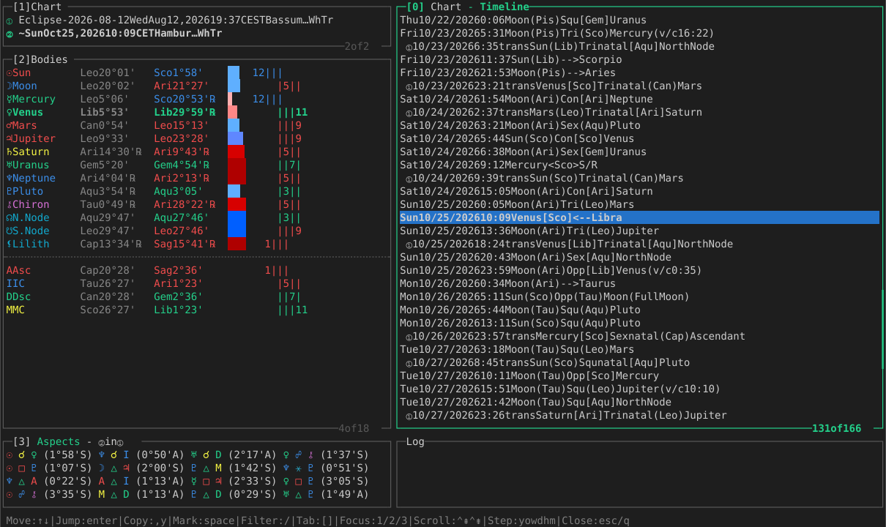

# Sextile

**Astrology at your fingertips.**

Open a chart.
Move through time.
Keep a moment worth returning to.

Sextile is a keyboard-operated workspace for [Astrolog](https://www.astrolog.org/). It puts charts, planetary positions,
aspects and a timeline on one screen, so you can follow a question as it develops.



Astrolog, created by Walter D. Pullen, computes every astrological value you see. Sextile arranges what it says and keeps
the commands in reach.

*Why a terminal?* Astrolog itself is a command-line tool, and the quickest way to learn what it can do is to watch the
commands go by while you work. Press `?` on the main screen and Sextile lists the keys that apply right there.

[Install and run](#install-and-run) · [Try one question](#try-one-question) · [Every key and setting](docs/REFERENCE.md) · [What changed](CHANGELOG.md)

## Install and run

Linux and Windows (from a WSL terminal) are tested. macOS is expected to work but is untested, so feedback is welcome.

First, fetch Sextile:

```bash
curl -fsSL https://raw.githubusercontent.com/cruiserxyz/sextile/v0.1.2/scripts/install | sh
```

The [install script](scripts/install) is short and worth a read. It puts Sextile in `~/.local/share/sextile/app` and a
small `sextile` command in `~/.local/bin`. It starts nothing, and it never edits your shell's settings. If `~/.local/bin`
is not on your PATH (the default on macOS), it prints the line to add. Other places and options are in the
[reference](docs/REFERENCE.md#install-options).

### With Docker

You need Docker 28 or newer, running.

```bash
sextile doctor
sextile
```

`sextile doctor` checks Docker, the port and the charts folder, and says what is wrong without changing anything. The
first run builds a Docker image with Astrolog 8.00 and its Swiss Ephemeris files. That takes a few minutes, and later
starts skip it.

### Without Docker

```bash
sextile --no-docker
```

This runs Sextile on your machine instead of in Docker. It needs Go and Astrolog 8.00. On Linux,
`scripts/build-astrolog` installs Astrolog in about two minutes. If either is missing, Sextile says so and names the script. It
never falls back to Docker on its own. More in [Without Docker](docs/REFERENCE.md#without-docker).

## First run

Sextile first asks which folder holds your charts. It proposes `~/.local/share/sextile/charts` and offers your documents
folder too. This is your charts folder from then on.

Then it opens on the floating chart, called Now. It shows the sky at the current minute, in a city proposed from your
time zone, and it can move freely through time. `Ctrl+L` chooses another city.

Sextile needs a terminal at least 66 columns wide and 15 rows high for one chart. Each further chart needs one more row.
At 132 columns, the Details panel and the Log appear beside the charts. Each further chart needs 12 more columns.

## What you can do

Each row of the Chart panel is a chart: one you opened, or the floating chart.

### Compare a chart with now

- The floating chart belongs to no file and moves freely in time. While it follows your computer's clock, its row reads
  `~ Now`.
- Open a chart with `Ctrl+O`, then select it and the floating chart with `Space`. The Aspects panel then compares Now
  with your chart, in your chart's houses and zodiac. It names whose body is whose.
- Now is never the chart others are read against.

### Move through time

- Step the floating chart by a year, a month, a week, a day, an hour or a minute, as fast as you hold the key. `n` brings
  it back to now.
- Its Timeline tab lists the events of the floating chart's month. When the floating chart is selected with other
  charts, it also lists their transits and returns.
- `Enter` on a timeline row moves the floating chart to that moment and highlights the body and aspect the row is about.
  It never changes which charts are selected.

### Change the view, not the file

- Choose the house system and zodiac for each chart. The chart file stays as it is.
- Choose which aspects (`Ctrl+A`) and bodies (`Ctrl+B`) are shown.
- Aspects are sorted by Astrolog's strength and marked applying or separating. Which ones matter is yours to judge.

### Keep a moment

- Put the cursor on the floating chart and press `Ctrl+S`. Type a title, and Sextile saves the moment and its city as a
  new Astrolog chart file in your charts folder. The new chart opens right away.
- To bring it back later, press `Ctrl+O`, type part of its title and press `Enter`.

### Keep a session

- A session remembers the charts you have open, which ones are selected, and their houses and zodiac. Sextile updates it
  as you work and restores it when you start again.
- `,` `o` opens the Sessions list. Its first row saves the open charts under a name of your choosing, a named session.
- To bring a named session back later, press `,` `o`, put the cursor on it and press `Enter`. Its charts replace the open
  ones. A named session opens only in the charts folder it was made in, and one that is open in another window cannot be
  opened twice.
- In the same list, `Ctrl+R` renames a session and `Ctrl+D` moves it to the trash.

### See the calculation

- The Log (`,` `l`) lists the Astrolog commands behind the screen. `Enter` copies one. Run it wherever Astrolog is
  installed and the same numbers come back. If you are new to Astrolog, it is also a good way to learn its switches.

## Your frame, whatever your school

Every chart's row in the Chart panel ends in a four-letter code for its frame, meaning its house system and zodiac. The
first two letters name the *houses*, the last two the *zodiac*.

`Ctrl+H` chooses the houses.
`Ctrl+Z` chooses the zodiac.

**Examples:**
`WhTr` is Whole Sign houses in the tropical zodiac. A *Hellenistic* reader will feel at home there.
`PlTr` is Placidus tropical for *Modern* practices.
`WhLa` is Whole Sign in the Lahiri zodiac for *Vedic* practices. There is no bare sidereal tag. A sidereal chart always
names its ayanamsa.

| House codes        | Zodiac codes       |
| ------------------ | ------------------ |
| `Pl` Placidus      | `Tr` Tropical      |
| `Ko` Koch          | `La` Lahiri        |
| `Wh` Whole Sign    | `Fa` Fagan-Bradley |
| `Eq` Equal         | `Ra` Raman         |
| `Po` Porphyry      | `Kr` Krishnamurti  |
| `Re` Regiomontanus |                    |
| `Ca` Campanus      |                    |

All 22 house systems and 11 zodiacs are in the [reference](docs/REFERENCE.md#frame-codes).

`,` `c` `d` makes the floating chart's frame your default, so every chart whose file names no house system opens in it.
Charts that are already open keep the frame they show.

## The panels

The Chart, Bodies and Aspects panels move together: change something in one, and the others follow.

The Aspects panel always has an `Aspects` tab for the chart under the cursor. When two or more charts are selected, it
also adds a tab such as `② in ①`. That tab reads the chart under the cursor in another selected chart's houses and
zodiac. `[` and `]` switch between them.

The house column of the Bodies panel is drawn the way you read houses best:

- `12 1 2 | 3 4 5 | 6 7 8 | 9 10 11` angularity at a glance (the default)
- `1 2 3 | 4 5 6 | 7 8 9 | 10 11 12` true quadrants
- `1`–`12` the plain number
- `1A 2s 3c …` the number with angular, succedent or cadent

`,` `a` opens a popup to choose, and `Space` picks the form under the cursor. The
[reference](docs/REFERENCE.md#house-display) shows each form in more detail.

## The graphical wheel

`Ctrl+X` draws the wheel as an image in your browser and redraws it as you move. It shows one chart, or a two-chart
comparison wheel with the chart being read against on the outer ring. `Ctrl+X` again closes it.

By default the wheel is served only on this machine, at 127.0.0.1, port 5307 or the next free one.

## Try one question

> What is this minute's sky doing to a fixed moment?

Here is an event chart, Hamburg at noon on 24 October 2026, 12:00 CEST (UTC+2):
[examples/Demo-Hamburg-2026-10-24.as](examples/Demo-Hamburg-2026-10-24.as).

1. Copy that file into your charts folder.
2. Press `Ctrl+O`, type `Hamburg`, press `Enter`. "Hamburg noon" joins the Chart panel above the floating chart. Nothing
   is selected yet, and opening a chart never moves the floating chart.
3. With the cursor on "Hamburg noon", press `Space`. Press `↓` to put the cursor on the floating chart and press `Space`
   again. Both are selected.
4. With the cursor still on the floating chart, press `]`. The Aspects tab reads `② in ①` (`2 in 1` without colour):
   this minute's bodies, read in Hamburg noon's houses and zodiac.
5. Press `h` a few times. Each press moves the floating chart an hour on. Hamburg noon stays, and the aspects re-sort as
   orbs close and open. `n` returns to now.
6. Press `,` then `l` to see the Astrolog commands behind what you just saw. `Enter` copies one, `Esc` closes.

To keep a stepped moment, choose its city with `Ctrl+L` and press `Ctrl+S` with the cursor on the floating chart. `?`
lists every key.

## Practical boundaries

- **Install.** Docker is the supported route. There are no prebuilt binaries, and the native build expects Linux.
- **What it writes.** Your charts folder holds only your chart files. Sextile saves a new chart there and never over an
  existing one. Everything else stays in your home folder: the session in `~/.local/state/sextile`, named sessions in
  `~/.local/share/sextile/sessions`, backups of retitled charts in `~/.local/share/sextile/backup`, and your preferences
  and choice of charts folder in `~/.config/sextile`. The session holds the titles, dates, times and places of your open
  charts, so it is chart data too. Sharing or syncing the charts folder shares your charts, not your sessions.
  [What Sextile keeps on disk](docs/REFERENCE.md#what-sextile-keeps-on-disk) has the details.
- **No birth-data form.** A chart for another moment is the floating chart stepped there and saved, or an Astrolog chart
  file you copy in.
- **No interpretation.** Details shows Astrolog's own reports. Sextile adds none of its own.
- **Bodies.** Drawn only within their ephemeris dates (about 1500 to 2100 for the eight added bodies), and no planetary
  moons. A comparison does not yet follow the body selection.
- **Several windows.** A second window starts with no charts and keeps nothing until you save it as a named session.
- **Keyboard only.** No mouse.

The full list: [Limits](docs/REFERENCE.md#limits).

## What comes next

Sextile casts nothing. Astrolog does, and every idea below keeps that promise. None has a date.

Throughout 0.1.x the work goes mostly into how Sextile looks and feels to use, with small steps in how it keeps your work.

- **Everyday reads, one key away.** Aspect patterns, dignities, midpoints, the lunar phase, risings and settings, each as
  a tab.
- **When is it exact?** One key for the last or next exact aspect, and a timeline over any span you choose.
- **Speak Astrolog directly.** Type a switch and it opens as a tab. Copy any tab out as one Astrolog command.
- **Charts with children.** Progressions, returns, relocations and rectification variants, linked to the chart they came
  from.
- **Ways of looking.** House system, zodiac or a heliocentric view, kept as named views that survive a restart.
- **More traditions.** Techniques as files: horary, time lords, Munich Rhythm, Uranian, each checked against a cited
  source.
- **Astrolog's own wheel in the terminal**, including Vedic chart forms.
- **1.0: a release you can cite**, with sessions you can replay and exports that carry their settings.

## Contribute

Most useful is a short account of the question you were pursuing, and where Sextile helped or got in the way. A chart that
breaks something is welcome, but never a real person's birth data. [CONTRIBUTING.md](CONTRIBUTING.md) has the commit
format and the check. [SECURITY.md](SECURITY.md) says how to report a vulnerability.

## Credits and licence

Sextile has two inspirations. [Astrolog](https://www.astrolog.org/), Walter D. Pullen's free astrology program, has
computed charts since 1991 and is the only thing here that computes the sky. [lazygit](https://github.com/jesseduffield/lazygit),
by Jesse Duffield, showed that a terminal program can make a tool's model visible without replacing it: panels for the
nouns, one key per verb, `?` for what applies here, and a log of the real commands it ran. Sextile makes that move for
Astrolog.

Astrolog calculates with the Swiss Ephemeris by Astrodienst AG. Its city atlas draws on GeoNames data. The interface is
built on Charm's [Bubble Tea](https://github.com/charmbracelet/bubbletea). Sextile is MIT-licensed (see [LICENSE](LICENSE)
and [CONTRIBUTORS](CONTRIBUTORS)). Astrolog, the Swiss Ephemeris and the atlas data keep their own licences.

*Sextile: the aspect of ease, when two planets sit 60° apart and work flows. Also the tool.*
