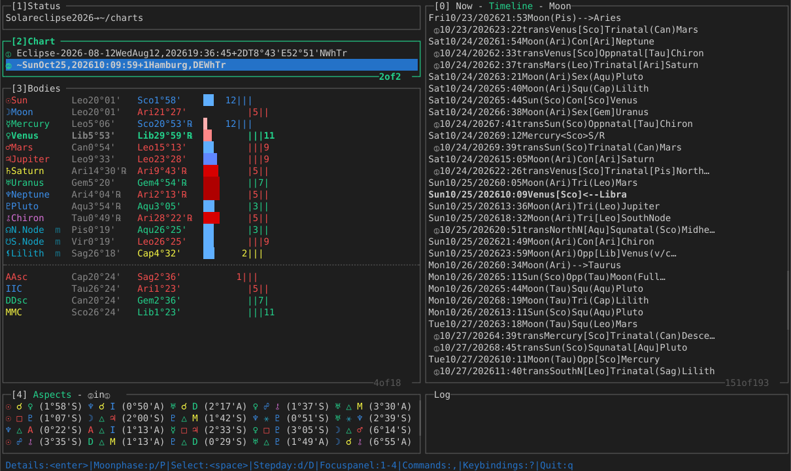
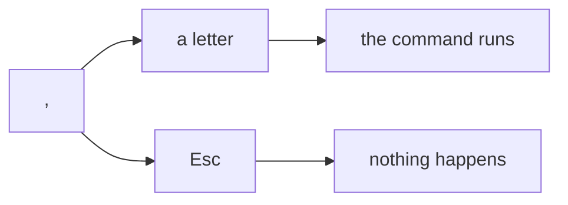

# Sextile

A terminal astrology suite.

> - a&nbsp;moment&nbsp;held ·&nbsp;the&nbsp;sky&nbsp;moving&nbsp;past&nbsp;it ·&nbsp;what&nbsp;forms&nbsp;and&nbsp;what&nbsp;passes ·&nbsp;exact&nbsp;to&nbsp;the&nbsp;second
> - your&nbsp;charts ·&nbsp;one&nbsp;screen ·&nbsp;many&nbsp;moments ·&nbsp;the&nbsp;keyboard,&nbsp;calm&nbsp;and&nbsp;quick
> - precise ·&nbsp;quiet ·&nbsp;it&nbsp;keeps&nbsp;up&nbsp;with&nbsp;you ·&nbsp;built&nbsp;to&nbsp;last



## What you see

Every part of the screen follows the chart you point at.

- **Status** names your session and your charts folder, and holds the credits.
- **Chart** lists the charts you opened. One of them is always **Now**, the sky of this minute.
- **Bodies** shows where each planet stands, with its sign and house.
- **Aspects** shows the aspects, the strongest first. With two charts selected, it shows the aspects between them.
- **Details** shows a full report on the chart, or the events of the month, day by day.
- **Log** tells you what Sextile did for you.

A small window opens two of these and folds the others to a title line. There, `Enter` opens Details below the
panel you are in.

## A short tour

This picture plays one minute of Sextile. Its chart is the first public release of Sextile itself.



1. `↓` moves from the chart to Now. `Enter` goes into Details, on the Timeline of the month. `]` shows the Moon,
   a second `]` the report of the chart, and `Esc` goes back.
2. `3` goes to Bodies, and Details shows the aspects of the planet under the cursor. `↓` walks through them all.
3. `4` goes to Aspects, and Details lists every aspect.
4. `Enter` goes into Details. `/` and the letters `ura` keep the rows with Uranus. `Esc` goes back.

## Before you start

Sextile is young. This is where it stands today.

- **It runs in a terminal window**, a text window where you work with the keyboard.
- **It needs Docker.** Docker is an app that runs Sextile with everything it needs. You install it once. Sextile
  has no installer of its own for Mac or Windows.
- **It is tested on Linux and on Windows.** On Windows it runs in a WSL terminal. A Mac is not tested yet.
  It should work there with Docker. Please tell us what happened.
- **Your chart files stay as they are.** Sextile's session and settings files may still change their form before
  version 0.2.
- **It asks before it writes** a chart into a folder that was yours before. Keep a backup of your charts folder,
  as of any folder you care about.
- **It has no form for birth data.** You make a chart from a moment and a city. Or you open a chart file of your
  own, as [the reference](docs/REFERENCE.md#use-your-own-chart-files) shows.

[Every limit, and what to do about it](docs/REFERENCE.md#limits) is in the reference.

## Install

You need `git`, `curl` and Docker 28 or newer. Start Docker first. Then paste this line into the terminal window:

```bash
curl -fsSL https://raw.githubusercontent.com/cruiserxyz/sextile/v0.1.4/scripts/install | sh
```

The [install script](scripts/install) is short, and you can read it first. It puts Sextile into
`~/.local/share/sextile/app` and adds a `sextile` command. It starts nothing and changes no settings.

Now check your computer, and start:

```bash
sextile doctor
sextile
```

`sextile doctor` looks at Docker and your charts folder. It tells you what is wrong and changes nothing.

The first start asks where your charts are, and offers a new folder. Then it sets up the calculations, which takes a
few minutes. Later starts are quick.

## Your first chart

Sextile opens on Now, the sky of this minute. This walk takes about a minute. At its end you have a chart of your
own, and the sky of today beside it.

| Step | Press | What you see |
|---|---|---|
| 1 | `p` | Now moves to the next Moon phase. The date in the Chart panel changes. |
| 2 | `,` then `s` | The comma shows the commands, and `s` is Save chart. Type a title when Sextile asks, such as `Full Moon`, and press `Enter`. The Moon phase is now a chart of yours, above Now. |
| 3 | `n` | Now returns to this minute. Your chart stays at the Moon phase. |
| 4 | `Space`, `↓`, `Space` | `Space` selects your chart, `↓` moves to Now, and `Space` selects Now too. Each selected chart carries a number, ① and ②. |
| 5 | `4` | You are in the Aspects panel. It shows the sky of this minute against your Moon phase. |
| 6 | `h`, a few times | The sky moves on, one hour at each press. Watch the aspects change. |

In step 2, Sextile may ask first, in a folder that was yours before Sextile. `y` saves this once, and `a` saves
new charts there from now on.

You made a chart, and you moved the sky past it. Everything else builds on these two things.

## The comma key

Press <kbd>,</kbd> and a letter, and the command runs. Most commands also answer to <kbd>Ctrl</kbd> and that letter.

- You need not learn the letters. After <kbd>,</kbd> the bottom line lists those of the place you are in.
- Over a popup, <kbd>,</kbd> offers the popup's own commands.
- <kbd>,</kbd> <kbd>?</kbd> opens Keybindings, the list of every key and command. <kbd>?</kbd> alone opens it too.
- <kbd>Esc</kbd> leaves, and nothing happens. There is no time limit.
- Another key can take the place of <kbd>,</kbd>, as [the reference](docs/REFERENCE.md#the-leader-key) shows.



## The keys you need first

| Press | What it does |
|---|---|
| `y` `o` `w` `d` `h` `m` `p` | step a year, month, week, day, hour or minute, or go to the next Moon phase |
| `Shift` with one of them | step back. `P` goes to the Moon phase before |
| `n` | return to now |
| `↑` `↓` | move between your charts |
| `Space` | select a chart to compare |
| `?` | show every key, in one list. Type to search it. |
| `q` | quit |

## What you can do next

Each of these goes on with the chart you made. The [reference](docs/REFERENCE.md) shows how.

- **[Move through time.](docs/REFERENCE.md#move-through-time)** Hold a key and the days pass. Follow the Moon from
  phase to phase, with its void-of-course times.
- **[Compare two charts.](docs/REFERENCE.md#compare-two-charts)** Open a birth chart beside your Moon phase. Read one
  in the houses of the other.
- **[Change the view.](docs/REFERENCE.md#houses-and-zodiac)** Try Placidus, then Whole Sign, then a sidereal zodiac.
  The chart file stays as it was.
- **[Keep your table.](docs/REFERENCE.md#sessions)** The charts you have open are a session. Give it a name, and the
  next start opens it again.
- **[Draw the wheel.](docs/REFERENCE.md#the-wheel)** See the chart as a wheel in your browser. It redraws as the
  sky moves.

## What Sextile keeps, and where

- **Your charts** stay in your charts folder, as plain text chart files. Before every change to one, Sextile keeps
  a dated copy.
- **Everything else** is in your home folder, outside your charts folder: your session, your settings and the dated
  copies. [Where files are](docs/REFERENCE.md#where-files-are) lists each place.
- **Sextile sends nothing.** It never goes online itself. Only the install and the first start download things.
  [What goes online](docs/REFERENCE.md#what-goes-online) lists them.

## More

- [The cheat sheet](docs/CHEATSHEET.md): one page to print
- [The reference](docs/REFERENCE.md): every key, setting and file
- [What changed in each release](CHANGELOG.md)
- [What may come next](docs/ROADMAP.md)

## Tell us

Did Sextile help with a question you had? Did it get in your way? A few lines are enough. Open a
[GitHub issue](https://github.com/cruiserxyz/sextile/issues). You need a free GitHub account for that.

To report a security problem, see [SECURITY.md](SECURITY.md). To contribute, see [CONTRIBUTING.md](CONTRIBUTING.md).

## Credits and licence

[Astrolog](https://www.astrolog.org/) by Walter D. Pullen calculates the charts. It dates from 1991, and it is the
only part here that computes the sky. It uses the Swiss Ephemeris by Astrodienst AG, and its city list draws on
GeoNames. Do you know Astrolog? [For Astrolog users](docs/ASTROLOG.md) gives your chart files, your settings and
the switches in its terms.

Jesse Duffield's [lazygit](https://github.com/jesseduffield/lazygit) showed how a terminal program can make a tool
visible. Sextile follows that idea for Astrolog. The screen is built with Charm's
[Bubble Tea](https://github.com/charmbracelet/bubbletea).

Sextile is MIT-licensed. See [LICENSE](LICENSE). Astrolog, the Swiss Ephemeris and the city data
keep their own licences.

*Sextile: two planets 60° apart, and work flows.*
