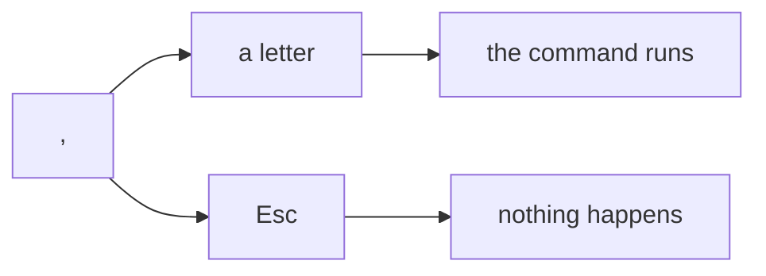

# Sextile reference

This page holds every key, setting, file and limit of Sextile 0.1.4. Find your task below, and follow its link.
To learn Sextile step by step, start with [Your first chart](../README.md#your-first-chart) in the README.

## I want to ...

- [open a chart](#open-a-chart)
- [save a moment as a chart](#save-a-moment)
- [use chart files I already have](#use-your-own-chart-files)
- [move through time](#move-through-time)
- [follow the Moon](#follow-the-moon)
- [compare two charts](#compare-two-charts)
- [change the houses or the zodiac](#houses-and-zodiac)
- [choose the mean or the true Node and Lilith](#the-nodes-and-lilith)
- [choose which planets and aspects show](#planets-and-aspects-on-screen)
- [set my city](#the-city)
- [keep a session and come back to it](#sessions)
- [know when Sextile writes into my charts folder](#when-sextile-writes-into-your-charts-folder)
- [see or copy the calculation](#the-calculation-and-the-log)
- [copy what is on the screen](#copy-what-you-see)
- [draw the wheel](#the-wheel)
- [take a chart off the list, and keep its file](#take-a-chart-off-the-list)
- [run a command](#the-leader-key)
- [find a key](#keys)
- [change a setting](#settings)
- [install Sextile](#install-and-start)
- [update Sextile](#update)
- [run Sextile without Docker](#without-docker)
- [find where my files are](#where-files-are)
- [know what goes online](#what-goes-online)
- [understand a message](#messages)
- [know what Sextile cannot do](#limits)

Do you use Astrolog itself? Read [For Astrolog users](ASTROLOG.md).

## The screen

Sextile runs in a terminal window, the window of text where you type commands. The screen has six panels.
Bodies, Aspects and Details show the chart under the cursor.

- **Status** names the session this window runs, and your charts folder. Its Details has two tabs. Credits
  names Sextile's version, licence and the programs it builds on. Session lists your saved sessions.
- **Chart** lists your open charts, one row each, and always **Now**, the sky of this minute. Each row ends in
  a tag for its houses and zodiac, which [Frame codes](#frame-codes) lists.
- **Bodies** shows each planet's sign, degree and house. A planet at a station shows `S/R` or `S/D` in place
  of its speed bar.
- **Aspects** lists the aspects, strongest first by Astrolog's measure, each marked applying or separating.
  With two charts selected, it lists the aspects between them.
- **Details** shows Astrolog's report on the chart or the planet under the cursor. Its Timeline tab lists the
  events of the month, and its Moon tab those of the Moon.
- **Log** tells you what Sextile did for you.

The key bar, the last line of the screen, shows the keys that work where you are.

A wide window shows Details and the Log on the right. A narrower window opens two panels: the one with the
cursor and its neighbour. Every other panel is one title line, and `Enter` opens Details below the panel with
the cursor. [Limits](#limits) gives the sizes.

A panel with more rows than it shows has a scroll mark at its right edge. Every astrological number on the
screen comes from Astrolog 8.00.

## Keys

Press `?` inside Sextile for the full list. `?` lists the keys of the place where you are, and every command.
A popup is a small window that opens over the screen.

### How keys are written

| Written | What you press |
|---|---|
| `p` | the key P |
| `P` | Shift and P together |
| `Ctrl+S` | Ctrl and S together |
| `,` `s` | the comma key, then S |
| `↑` `↓` `←` `→` | the arrow keys: up, down, left and right |
| `PgUp` `PgDn` | Page Up and Page Down |
| `Space` `Enter` `Esc` `Tab` `Delete` | the keys with these names |

On a Mac keyboard, Ctrl is the Control key, not the Command key. `Enter` is the Return key.

### Move on the screen

These keys work on the main screen.

| Key | What it does |
|---|---|
| `Tab` or `→` | go to the next panel |
| `Shift+Tab` or `←` | go to the panel before |
| `1` `2` `3` `4` | go to Status, Chart, Bodies or Aspects |
| `↑` `↓` | move up or down one row |
| `k` `j` | the same as the up and down arrows |
| `PgUp` `PgDn` | move up or down one page |
| `Home` `End` | go to the first or the last row |
| `g` `G` | the same as Home and End |
| `Enter` | go into [Details](#details). In a narrower window, open it below the panel |
| `0` | show the next tab of Details. In a narrower window, open Details below the panel first |
| `[` `]` | switch the tab. In a comparison, [choose the other chart](#compare-two-charts) |
| `Ctrl+PgUp` `Ctrl+PgDn` | scroll Details up or down, from any panel |
| `Space` | select the chart or the planet under the cursor |
| `K` `J` | move the chart up or down in the list |
| `Shift+↑` `Shift+↓` | the same as K and J |
| `Delete` | take the chart off the list. Its file stays |
| `?` | open [Keybindings](#every-command-in-one-list), the list of every key |
| `Esc` | close a popup, or go back |
| `q` | quit. In Details and in the log console it closes them |
| `Ctrl+C` | quit from anywhere |

`Space` on a chart starts a [comparison](#compare-two-charts). On a planet, it
[shows only some planets](#show-only-some-planets).

### Move through time

These keys move Now, in every panel and in Details. A small letter steps forward, and the capital letter steps
back. Hold a key down, and it repeats.

| Key | What it does |
|---|---|
| `y` `Y` | step a year |
| `o` `O` | step a month |
| `w` `W` | step a week |
| `d` `D` | step a day |
| `h` `H` | step an hour |
| `m` `M` | step a minute |
| `s` `S` | step a second |
| `p` `P` | go to the next or the previous Moon phase |
| `n` | return to this minute |

A chart you opened or saved keeps its moment. [Now follows the clock](#now-follows-the-clock) says more.

### The leader key

<kbd>,</kbd> is the leader key. Press <kbd>,</kbd>, then a letter, and the command runs.
So <kbd>,</kbd> <kbd>o</kbd> opens a chart.



- After <kbd>,</kbd> the key bar lists the letters of the place you are in, in bold, as many as fit. It waits
  for your letter, with no time limit.
- <kbd>?</kbd> after <kbd>,</kbd> opens Keybindings. <kbd>Esc</kbd> leaves. A letter that is not listed closes
  the list and does nothing.
- Over a popup, <kbd>,</kbd> offers the popup's own commands, such as renaming in the chart list. Where a
  place has none, <kbd>,</kbd> does nothing.
- Most commands also answer Ctrl and the same letter, so <kbd>Ctrl+O</kbd> opens a chart too.
  <kbd>O</kbd>, <kbd>L</kbd> and the commands after <kbd>,</kbd> <kbd>c</kbd> have no Ctrl form.
- <kbd>c</kbd> leads to the defaults. The key bar shows it as `c defaults…`, and then `d save defaults`.
  <kbd>,</kbd> <kbd>c</kbd> <kbd>d</kbd> saves them.
- Keybindings, opened with <kbd>?</kbd> or <kbd>Ctrl+P</kbd>, is the second way to every command.
- The leader can be another single key. Write `leader: ","` under `keys:` in the settings file
  `preferences.yaml`, with your key in place of the comma. A key that cannot start a command is refused, and
  the Log says so.

### Commands

A command opens a popup or does one thing. This table lists each command with its keys.

| Command | Leader | Ctrl | Where to read more |
|---|---|---|---|
| Open a chart | `,` `o` | `Ctrl+O` | [Open a chart](#open-a-chart) |
| Sessions | `,` `O` | none | [Sessions](#sessions) |
| Save Now as a chart | `,` `s` | `Ctrl+S` | [Save a moment](#save-a-moment) |
| Choose the city | `,` `l` | `Ctrl+L` | [The city](#the-city) |
| The Log | `,` `L` | none | [The calculation and the Log](#the-calculation-and-the-log) |
| Choose the houses | `,` `u` | `Ctrl+U` | [Houses and zodiac](#houses-and-zodiac) |
| Choose the zodiac | `,` `z` | `Ctrl+Z` | [Houses and zodiac](#houses-and-zodiac) |
| Choose the Nodes and Lilith | `,` `t` | `Ctrl+T` | [The Nodes and Lilith](#the-nodes-and-lilith) |
| Choose the aspects | `,` `a` | `Ctrl+A` | [Planets and aspects on screen](#planets-and-aspects-on-screen) |
| Choose the planets | `,` `b` | `Ctrl+B` | [Planets and aspects on screen](#planets-and-aspects-on-screen) |
| Draw the wheel | `,` `x` | `Ctrl+X` | [The wheel](#the-wheel) |
| Copy | `,` `y` | `Ctrl+Y` | [Copy what you see](#copy-what-you-see) |
| List every command | `,` `?` | `Ctrl+P` | [Every command in one list](#every-command-in-one-list) |
| Keep all defaults | `,` `c` `d` | none | [Keep your defaults](#keep-your-defaults) |
| Protect the charts folder, or not | none. Run it from Keybindings | none | [When Sextile writes into your charts folder](#when-sextile-writes-into-your-charts-folder) |

### Every command in one list

`?` opens Keybindings, the list of every key and every command. `Ctrl+P` and `?` after `,` open it too.
`Esc` or `?` closes it.

- The list has three parts. Local holds the keys of the place where the cursor is. Global holds the commands.
  Navigation holds the keys that move through time and across the screen.
- The commands you ran last come first. Sextile keeps the last five with the session.
- Type a few letters to keep the rows that match. Type `@` first to search by key: `@ctrl` keeps the rows
  with a Ctrl key.
- `Enter` runs the row under the cursor. `Esc` clears what you typed, and a second `Esc` closes the list.
- A row that is struck through cannot run now, and ends in `(n/a)` with colour off. A row that ends in `…`
  opens a popup.
- The list writes keys as `<ctrl+l>`, `<enter>` or `<up>`, where this page writes `Ctrl+L`, `Enter` and `↑`.

### Lists and choosers

Most commands open a popup with a list. A chooser adds a line to type in, where a letter is text.
So `q`, `j` and `k` type there, and the arrow keys move.

| Key | What it does |
|---|---|
| a letter | type it, and the list keeps the rows that match |
| `↑` `↓` | move up or down one row |
| `PgUp` `PgDn` | move up or down one page |
| `Home` `End` | go to the first or the last row |
| `Enter` | take the row under the cursor |
| `Space` | mark or tick the row, in a list with marks |
| `Tab` | go to the next field of a form, such as the rename form |
| `Ctrl+R` | rename the chart or the session under the cursor |
| `Ctrl+D` | move the session under the cursor to the trash |
| `Esc` | close the popup |

Some popups ask a question and show buttons.

| Key | What it does |
|---|---|
| `←` `→` | light the button to the left or to the right |
| `Enter` | take the lit button |
| `y` | Yes |
| `n` | No |
| `a` | Always, in the [question before a new chart](#when-sextile-writes-into-your-charts-folder) |
| `c` | Cancel, in the [question before a new session](#sessions) |
| `Esc` | No, or Cancel where there is one |

### Details

`Enter` on the main screen moves the keyboard into Details, where the time keys and the commands still work.
In a narrower window, Details opens below the panel with the cursor. That panel then shows only the row under
the cursor, with one row above and one below. Leave Details, and it closes again.

| Key | What it does |
|---|---|
| `↑` `↓` | move one row in a list. Scroll one line in a report |
| `Enter` | on the Timeline or the Moon tab, move Now to the moment of the row, and leave Details |
| `Space` | mark the row, for [copying](#copy-what-you-see) |
| `/` | [filter the rows](#filter-the-rows-of-details) |
| `[` `]` | switch the tab |
| `1` `2` `3` `4` | go to Status, Chart, Bodies or Aspects. In a narrower window, Details follows to that panel |
| `Tab` | go to the next panel. In a narrower window, Details follows |
| `→` | nothing |
| `Esc`, `q` or `←` | leave Details |

### The Log and the log console

`,` `L` gives the keyboard to the Log panel. A narrow window has no Log panel, and the log console opens there.
These keys work in the Log panel.

| Key | What it does |
|---|---|
| `↑` `↓` | move up or down one line |
| `Enter` | copy the line under the cursor |
| `,` `y` | copy every line |
| `l` | open the log console |
| `Esc` or `q` | go back to the main screen |

Any other key goes back first, then acts as on the main screen.

The log console lists the Astrolog commands. These keys work there.

| Key | What it does |
|---|---|
| `↑` `↓` | move up or down one line |
| `Enter` | copy the whole command under the cursor |
| `,` `y` | copy every command |
| `Esc` or `q` | close the log console |

[The calculation and the Log](#the-calculation-and-the-log) says what the lines mean.

## Charts

A chart is one chart file in your charts folder, in Astrolog's format. Sextile reads the folder freely, and
asks before it writes into a folder that was yours before.
[When Sextile writes into your charts folder](#when-sextile-writes-into-your-charts-folder) says more.

### Open a chart

1. Press `Ctrl+O`. The list of your charts opens, each row with its place and its date. The number in
   brackets after the name counts the full years from the chart's date to today.
2. Type a few letters to shorten the list.
3. Press `Enter` on the chart you want.

To open several charts, press `Space` on each, then `Enter`. Ticked charts stay at the top while you type.
The chart gets a row in the Chart panel, not selected. Opening a chart changes no file.

### Save a moment

Sextile saves Now as a new chart, with the moment and the city of Now.

1. Move Now to the moment. Use the [time keys](#move-through-time), or `Enter` on a row of the Timeline.
2. Set the city with `Ctrl+L`, if it is not the right one.
3. Put the cursor on Now.
4. Press `Ctrl+S`. Type a title, and press `Enter`.

The new chart opens at once, with the cursor on it.

- The file name comes from the title: `Full Moon` becomes `full-moon.as`. Letters a to z and digits stay, in
  small letters, and anything else between them becomes one `-`.
- A save never replaces a chart that exists.
- The file keeps the moment to the second, in the clock of the city. Before the city had standard time, it
  states local mean time.
- In a folder that was yours before Sextile, each save
  [asks until you answer Always](#when-sextile-writes-into-your-charts-folder).

### Use your own chart files

Sextile reads chart files in Astrolog's format. Copy them into your charts folder, and press `Ctrl+O`.

- Sextile lists every chart in the folder, whatever the file is called. A file whose name starts with a dot is
  left out. Each chart must be a file of its own.
- Of every other file, Sextile reads only the first bytes, to see that it is not a chart. It changes none.
- Sextile uses only the lines that describe the chart: moment, place, title, houses and zodiac. A file's own
  bodies, aspects or orbs are left out, and the Log says so once.
- A file that could do more than describe a chart does not open. The chart list marks it with a red `!`, and
  says why under the cursor. `Enter` does nothing there.
- A file that asks for another kind of chart, such as heliocentric or harmonic, does not open yet.
- A title or a place longer than 54 bytes does not open. An accented letter counts as two.
- A file with no title asks for one when you open it. Type it, and press `Enter`. Sextile then asks before it
  changes the file.

A chart file is a few lines of plain text. Sextile saves a chart as `name.as`, which Astrolog itself opens.
[For Astrolog users](ASTROLOG.md#your-chart-files) shows a file line by line, and what Sextile does with each.

### The clock and the place of a chart

A chart's row shows the date, the clock and the zone that its file states.

| The zone says | What it means |
| --- | --- |
| `+1` | the clock is one hour ahead of Greenwich. `+5:30` is five and a half hours ahead, `-4` four hours behind |
| `+2 DT` | daylight saving time. The number already holds the extra hour |
| `LMT` | local mean time, the clock of the place itself. Charts from before standard time use it |

- The clock minus the number is universal time. Every clock shows its seconds. [Limits](#limits) names the
  rare cases where the number is cut.
- Sextile shows no zone letters such as CET. The same letters name different zones in different countries.
- The report in Details writes the zone, not the clock. A summer clock in Berlin reads `DT Zone 1E` there,
  and `+2 DT` on the row.
- The place is the file's own words. If no city of that name lies near the file's coordinates, the row shows
  the coordinates first. The words follow in brackets: `3°12'W 55°57'N (Amsterdam)`.
- A file that names no place shows its coordinates. A chart at sea or far from a town is listed like any other.
- The file's house system and zodiac start the chart. See [Houses and zodiac](#houses-and-zodiac).
- The coordinates stand in the chart file. Sextile wrote them from the city of Now when you saved the moment,
  or they came with your file. Sextile cannot change them yet. The form that names a chart shows them, but
  changes only the name of the place.

### Take a chart off the list

In the Chart panel, put the cursor on the chart and press `Delete`. The row goes, and the file stays in your
charts folder, so `Ctrl+O` opens it again. Now cannot be taken off.

### Rename a chart

1. Press `Ctrl+O`, and move to the chart.
2. Press `Ctrl+R`. A form opens with the title and the name of the place, and `Tab` moves between the two. It
   also shows the coordinates from the file, but does not change them.
3. Change the text, and press `Enter`.

Sextile then shows what changes: the file, the old and new text, and the name of the
[dated copy](#when-sextile-writes-into-your-charts-folder). `y` makes the change. `n` and `Esc` go back to
the form, with your text kept.

## Time

### Now follows the clock

Now starts on this minute and follows the clock. Its row reads `~ Now`.

- A time key, `p`, or `Enter` on a row of the Timeline stops Now at the new moment. The row then reads `~`.
- `n` returns Now to this minute, and it follows the clock again.
- The time keys always move Now, wherever the cursor is.
- No key goes back to the moment before: Sextile has no undo.
- Before your city had standard time, Now shows local mean time. A step through 1582 follows the change from
  the Julian to the Gregorian calendar.

### The Timeline

The Timeline is a tab of Details while the cursor is in the Chart panel. The cursor must be on Now, or on a
chart selected together with Now. It lists the events of the calendar month of Now.

- On Now, it lists the sky of that month. With Now and other charts selected, it adds the transits and
  returns of each selected chart.
- The bold row is the moment of Now.
- `Enter` on a row moves Now to that moment, and leaves Details. It selects no chart.
- `Space` marks a row, and `,` `y` copies the marked rows.

### Follow the Moon

`p` moves Now to the next Moon phase, and `P` to the phase before. The phases are New Moon, first quarter,
Full Moon and last quarter.

The Moon tab of Details comes after the Timeline, and works like it.

- It lists the Moon's aspects, sign changes and phases of the month. With charts selected, it adds the Moon's
  contacts with each of them.
- A row carries Astrolog's void-of-course mark where one applies.
- In Bodies, the Moon's row shows `v/c` while the chart's moment falls in a void. A faint `·` there means that
  the answer is on its way, and a faint `?` that Astrolog's search failed.

### Filter the rows of Details

On the Timeline, the Moon tab and a report that is one list, press `/` and type. Only the rows that hold your
text stay. Capital and small letters count the same.

- While the line is open, it only types. The list shows no cursor row, and the arrow and page keys do nothing.
- `Enter` closes the line, which turns faint, and the filter stays. The cursor comes back on its row. If that
  row is gone, it goes to the next event after Now, or else to the last row.
- A second `Enter` moves Now to the row's moment, and leaves Details.
- `Backspace` on an empty line closes it. `Esc` closes the line, and brings back the filter it opened with.
  `Esc` on the list leaves the filter as is.
- A filter ends when you delete its text, or when Now moves in time or place.
- When no row matches, the list says `no row matches`. On a report, the lines below the list, such as the sum
  of powers, hide while the filter has text.
- Press `/` twice, before you type, for a loose match: the letters in this order, with others between them.
  Press it three times for an exact match, where capital and small letters differ.

## Compare two charts

1. Put the cursor on a chart in the Chart panel, and press `Space`.
2. Move to a second chart, and press `Space` again.

Two selected charts start a comparison. The Aspects panel opens on the comparison with the chart you selected
before, such as `② in ①`. The wheel shows both charts. `Space` on a selected chart takes it out again.
You can select up to six charts.

A comparison reads one chart in another.

- The chart under the cursor is the chart you read. The Aspects panel gets a tab for each other selected
  chart. `[` and `]` choose the chart you read against.
- The tab names both charts by their numbers, such as `② in ①`, or `2 in 1` without colour.
- The chart you read against gives the houses and the zodiac of the comparison. Now is never that chart.
- Each aspect names the planet of your chart first, and the planet of the other chart second.
- Bodies shows each planet's position in every selected chart, side by side. Your chart's stands in brackets,
  and the panel's title names the pair. Each row then shows two houses, which
  [House display](#house-display) tells apart.
- With the cursor on a saved chart and only Now selected beside it, there is no chart to read against. The
  chart's own tab shows.

## The view

### Houses and zodiac

`Ctrl+U` opens the houses chooser, and `Ctrl+Z` the zodiac chooser.

- Each changes only the chart under the cursor, which the popup's title names. Every other chart keeps its
  own houses and zodiac, and the chart file stays as it was.
- `Enter` uses the row under the cursor, and closes the popup. `Esc` closes it, and nothing changes.
- A chooser keeps no default. [Keep your defaults](#keep-your-defaults) shows how to keep one.
- A chart file can name its house system, and the chart opens with it. A file that names none opens with your
  default, Whole Sign until you keep another.
- The zodiac is tropical until you choose another.
- The houses chooser has a second part, **Houses shown as**. `↓` from the last house system goes into it, and
  `↑` leaves it. See [House display](#house-display).

Astrolog's sidereal zodiacs are fixed offsets from Fagan-Bradley. Each chart is precessed to its own date.
So a sidereal comparison differs from the tropical one by the precession between the two dates.

### Frame codes

Every row of the Chart panel ends in a tag, most often of four letters. The first two name the house system,
and the last two the zodiac. `WhTr` is Whole Sign houses in the tropical zodiac. A sidereal zodiac is always
named by its ayanamsa. The two tables list every code, in Astrolog's own order.

| House code | House system |
| --- | --- |
| `Pl` | Placidus |
| `Ko` | Koch |
| `Eq` | Equal |
| `Ca` | Campanus |
| `Me` | Meridian |
| `Re` | Regiomontanus |
| `Po` | Porphyry |
| `Mo` | Morinus |
| `To` | Topocentric |
| `Al` | Alcabitius |
| `Ks` | Krusinski |
| `EM` | Equal (MC) |
| `PR` | Pullen (S.Ratio) |
| `PD` | Pullen (S.Delta) |
| `Wh` | Whole Sign |
| `Ve` | Vedic |
| `Sr` | Sripati |
| `Hz` | Horizon |
| `AP` | APC |
| `CP` | Carter P.Equat. |
| `Su` | Sunshine |
| `Sa` | Savard-A |

| Zodiac code | Zodiac |
| --- | --- |
| `Tr` | Tropical |
| `Fa` | Fagan-Bradley |
| `La` | Lahiri |
| `De` | Deluce |
| `Ra` | Raman |
| `Us` | Usha-Shasi |
| `Kr` | Krishnamurti |
| `Dj` | Djwhal Khul |
| `Yu` | Yukteshwar |
| `Bh` | J.N. Bhasin |
| `Gc` | Galactic Center |

A chart file can ask for something outside these tables. The tag then says so in a short mark.

| Mark | What it means |
| --- | --- |
| `#23Tr` | a house system that the table does not hold, by Astrolog's number. The houses chooser names it |
| `3PlTr` | 3D houses, here with Placidus |
| `Pl+2.5` | a sidereal zodiac with its own offset in degrees, in place of a named ayanamsa. Astrolog counts the offset from Fagan-Bradley |
| `Po*Tr` | you chose another house system, and Astrolog cast this one. The Log says why |

The tag names what Astrolog cast. In the far north Astrolog cannot cast Placidus or Koch. It casts Porphyry,
the tag says `Po*`, and the Log says what was asked for.

### House display

The house column of the Bodies panel has four forms. You choose one in the **Houses shown as** part of the
houses chooser. The choice holds for the session and for every chart.

- **Angularity at a glance** (`angularity`, the default). The houses stand in groups around the four angles:
  Ascendant, IC, Descendant and Midheaven. The frame is `12 1 2 | 3 4 5 | 6 7 8 | 9 10 11`. In each group the
  middle house is angular, the right one succedent and the left one cadent.
- **True quadrants** (`quadrants`). The houses stand in the four quadrants, counted from the Ascendant:
  `1 2 3 | 4 5 6 | 7 8 9 | 10 11 12`.
- **Plain number** (`number`). The house number alone.
- **Number + angularity** (`marked`). The house number with `A` for angular, `s` for succedent and `c` for
  cadent: `1A`, `2s`, `3c`, `4A`.

All four fill the same 18 cells, so the Bodies panel keeps its width.

In a comparison a row carries two houses: the chart's own house faint, the house in the compared chart bold.
This holds in every form. Without colour, their order tells them apart.

Sextile keeps the default form as the `house_display:` line of `preferences.yaml`. A word it does not know
there is refused in the Log, and `angularity` stands.

### The Nodes and Lilith

`Ctrl+T` opens the chooser of the Moon's Nodes and Lilith, for the chart under the cursor. It lists four
pairs: mean and mean, true and true, and mean or true Node with natural Lilith. `●` marks the pair the chart
shows. `Enter` uses the pair under the cursor, and closes. The right column says `from its file` beside the
pair of the chart's file, or else `your default`.

- **The three forms.**
  - Mean: the Node and Lilith of the Moon's average orbit (the Swiss Ephemeris's mean node and mean apogee).
    The common "Black Moon Lilith".
  - True: the Node and Lilith of the Moon's orbit at that moment (the true node and the osculating apogee).
    True Lilith can jump by up to 30°.
  - Natural: Lilith only, the Swiss Ephemeris's interpolated apogee, its answer to the jumps of the true one.
- **Which form a chart shows.** Your choice for that chart in the session comes first. Then comes what its
  file asks for, then your default, else the mean pair. The file's Node lines count in order, as Astrolog
  reads them.
- **The letter.** In Bodies, `m`, `t` or `n` follows the names of the North Node, the South Node and Lilith.
  It says the form Astrolog cast that row in. Details names it in words in its title, such as
  `North Node (true)`.
- **In a comparison,** both charts get the form of the chart the comparison is read against. Each keeps its
  own houses and zodiac. The Timeline and the Moon tab use each chart's own form, and the sky list uses Now's.
- **Two pairs cannot be shown yet.** [Limits](#limits) names them, and says why.
- **No chart file changes.** The session keeps the choice. A chart saved from Now carries no Node line.

### Planets and aspects on screen

`Ctrl+B` opens the list of planets and other bodies, and `Ctrl+A` the list of aspects. `Space` ticks a row or
takes the tick away, and the screen changes at once. `Enter` and `Esc` both close the popup and keep the ticks.

The list of bodies has more in it.

- Sextile remembers your ticked bodies at the next start. A named session keeps its own.
- Its first row, **+ Restore the default bodies**, ticks the default bodies again.
- Seven rows are groups: Planets, Angles, Points, House cusps, Asteroids, Uranians and Other. A group row
  ticks all its bodies together, and counts the ticked ones.
- A body that Astrolog cannot draw carries a `!` and stands last. With the cursor on it, the last line shows
  Astrolog's own message. [Limits](#limits) says what to do.

### Show only some planets

Put the cursor on a planet in Bodies, and press `Space` to select it. The wheel, the aspects and the report of
that chart then show only the selected planets.

- Bodies keeps every row, so you can select more. With nothing selected, everything shows.
- A planet without a tick in the chooser stays hidden.
- In a comparison, the selection does not reach the aspects between the two charts yet.

### The city

The city is the place of Now. A chart you opened keeps its own place, and its times use that place.

- At the first start, Sextile proposes a city from your time zone, and the Log names it.
- `Ctrl+L` opens the city chooser. Type the name of a city, and press `Enter`.
- That city holds for this session. [Keep your defaults](#keep-your-defaults) makes later starts use it too.

### Keep your defaults

`,` `c` `d`, or Keep as defaults from Keybindings, keeps five things for every later start:

- the city of Now
- the house system of Now
- the zodiac of Now
- the form of the Nodes and of Lilith of Now
- how the houses are shown

Charts that are open keep what they show. The command works in the first Sextile window only.
[Settings](#settings) says where the defaults are kept.

## Sessions

The charts you have open are a session. It also holds which charts are selected, and their houses and zodiac.
Sextile keeps it up to date while you work. Quit and start again, and the charts come back, with Now on this
minute.

`,` `O`, or Sessions from Keybindings, opens the Sessions list.

| Row of the list | What `Enter` does |
|---|---|
| **+ Save this session as…** | asks for a name, and saves the session under it |
| **+ New, unnamed session** | closes every chart, and starts an empty session |
| a saved session | saves the session you leave, then opens the saved one |

`Ctrl+R` renames the session under the cursor. `Ctrl+D` moves it to the trash at once, and the Log names the
place.

- **Save under a name.** The name field offers the title of the first selected chart. A name that exists is
  refused, and nothing is written. From then on, this window keeps the named session up to date.
- **A new session.** Every chart closes, and nothing is selected. Now stays. The houses, the zodiac and the
  planets go back to your defaults. No chart file is removed.
- **Before a new session**, an unnamed session with a chart in it asks **Save this session first?** Yes is
  lit, and opens the name field. The new session starts after the save. No starts it at once, and the list
  of open charts is gone for good. Cancel and `Esc` go back to the list.
- **The list** holds the sessions of this charts folder, newest first, each with the time of its last update.
  A session open in another window cannot be opened, renamed or moved to the trash. Nor can the session this
  window runs go to the trash: open another session first.
- **The next start** opens the session you used last in this charts folder. If it is gone, or open in another
  window, Sextile starts the unnamed session, and the Log says why.
- **A second window.** A session is open in one window only. A later window starts with no charts, and keeps
  nothing until you save it under a name.
- **Another charts folder.** The unnamed session belongs to one charts folder. Started on another folder,
  Sextile opens with no charts, and the Log says why. The saved session stays as it was.

To start in a named session, run `sextile -- --session NAME`.

<a id="protect-the-charts-folder"></a>

## When Sextile writes into your charts folder

Sextile reads your charts folder freely. It writes there in two cases only. You save a chart, or you change
the title or the place of one.

- **A new chart** asks first, in a folder that was yours before Sextile. The buttons are Yes, Always and No,
  and No is lit. `y` saves this chart. `a` saves it, and later new charts there need no question. `n` and
  `Esc` go back to the title. In a folder that Sextile created, new charts need no question.
- **A change** asks first, with the buttons Yes and No, and No lit. Sextile names the file, what changes and
  the dated copy it keeps. `y` makes the change. `n` and `Esc` go back.
- **The dated copy.** Sextile copies a chart file before every change, outside your charts folder. The copy's
  name holds the date and the time in UTC, such as `name.20261113T091800Z.as`. Sextile never replaces or
  deletes a copy.
- **The journal.** Each charts folder has one, and every write adds a line. The line holds the time in UTC,
  the act, the file name and the name of the copy. It also holds the SHA-256 of the file before and after.
  The act is `add`, `change`, or `failed` for a write that did not happen.
- **One window writes at a time.** The first Sextile window that writes into a charts folder keeps it until
  it quits. Another window reads the folder freely. A save or a rename there writes nothing, and Sextile says
  so. After the first window quits, the next window that writes takes the folder.
- **Protect the charts folder, or not**, in Keybindings, makes Sextile write nothing there, or ask again.
- **`sextile --originals WORD`** sets how Sextile writes into the folder. [Settings](#settings) names the words.

[Where files are](#where-files-are) names the place of the copies and of the journal.

## The calculation and the Log

Sextile shows the Astrolog command behind every number.

1. Press `,` `L`, or run Log from Keybindings. The Log panel takes the keyboard.
2. Press `l`. The log console opens with the Astrolog commands behind the screen.
3. Move to a command, and press `Enter`. Sextile copies the whole command.

Run the copied command with Astrolog, and the same numbers come back.

- The command for one chart holds the chart itself: its moment, place, title, houses and zodiac. It needs no
  file.
- The command for a comparison names copies of the charts, made for that one call and gone afterwards. To run
  it yourself, put your own chart files in their place.
- Each line starts at the part that names the chart, and leaves out the start that all commands share.
  `Enter` still copies the whole command.
- A line that is too wide ends in `…`. A command that Astrolog failed on carries a red `!`, plain without
  colour.
- While Now follows the clock, one `now:` line stands for it, always the last. So the console holds the
  command behind the screen and every step you took, but no line for every minute.
- A narrow terminal window has no Log panel. There `,` `L` opens the log console at once.

The Log panel speaks only about your charts and what you asked for. How Sextile works with Astrolog is in the
log console only.

- A line in the Log panel starts with its group, such as `Chart`, `Folder`, `Settings` or `Astrolog`, then the
  message. The log console names the same group before the message, as `chart: 3 rows copied`.
- The group is cyan, `Settings` is yellow and `Astrolog` is magenta. An error is red. Without colour, an
  error's message starts with `! `.

### How the numbers are checked

Sextile calculates nothing. The tests hold 36 chart files, from the first century BC to today. They reach from
near the equator to beyond the polar circle.

- For each file, the positions that Sextile asks Astrolog for are compared with Astrolog reading the file
  itself. The comparison goes to the second of arc, and covers 21 bodies, both angles and the twelve cusps.
- What the screen then shows of the planets and the angles is compared with Astrolog's own output, to the
  minute.
- A release does not pass with a difference.
- Aspects, the Timeline and the wheel picture are not checked this way.

A settings file of Astrolog on your computer cannot change a position, a house or a moment.
[For Astrolog users](ASTROLOG.md#your-settings-file) says what Sextile does with one.

### Copy what you see

`,` `y` copies the whole content of the part that has the keyboard. Each row becomes one line of text.

| Where the keyboard is | What is copied |
|---|---|
| Chart | the selected charts. With none selected, every row |
| Bodies or Aspects | every row, as shown, without colour |
| Details, on the Timeline or the Moon tab | the marked rows. With no marks, every row |
| Details, on a report | the whole report |
| the Log | every line |
| the log console | every command, with the moment and the place of every open chart |

`Enter` in the Log or in the log console copies one line.

Sextile shows `Copied` after it sent the text to your terminal window. [Limits](#limits) says what to do when
nothing arrives, and what a clipboard program with a history keeps.

## The wheel

Press `Ctrl+X`. Astrolog draws the wheel of the chart, and your browser shows it. The wheel redraws when you
move through time.

- The Log names the address: `Wheel at http://localhost:5307 (Ctrl+X again closes it)`. Only your own
  computer can reach that address.
- A second `Ctrl+X` closes the wheel, and a third opens it again at the same address. This is so when you
  start with `sextile`. [Without Docker](#without-docker) names one other case.
- The browser opens only at the first `Ctrl+X`. Later, the tab you left open connects again. If it does not,
  reload it. With no browser opener on your system, type the address into the browser yourself.
- The wheel shows what the Aspects panel shows. On the chart's own tab, it is the wheel of that chart alone.
  On a comparison tab, such as `② in ①`, it is a wheel of both charts. `[` and `]` switch the tab. A wheel of
  three or more charts is not drawn.
- With planets selected in Bodies, the wheel of one chart shows only those planets. A wheel of two charts
  shows all.

| To change | Do this |
|---|---|
| the address, when 5307 is in use | start with `sextile --port 5308` |
| the browser opening by itself | start with `sextile --no-open` |
| the picture format | put `wheel_format: png` into `preferences.yaml`. The default is `svg` |

A second Sextile window takes the next free port, and prints which one.

## Install and start

Docker is an app that runs Sextile with everything it needs. The README's [Install](../README.md#install) has
the one line that fetches Sextile. This section holds the rest.

### What the install script does

- It needs `git` and `curl`. It needs Docker 28 or newer to run Sextile, not to install it.
- It puts Sextile into its own folder in your home folder. Set `SEXTILE_DIR` to choose another folder.
- It writes a `sextile` command, and never replaces a file there that it did not write.
- When your terminal window cannot find `sextile` yet, it prints one line. Add that line as it says.
- It changes no settings, and it starts nothing. It warns when Docker is not open, and goes on.
- It refuses a folder that exists and is not Sextile. Changes that you made inside Sextile's folder stop it.
- An older copy of Sextile in `~/sextile` is no longer used. The script says so, and leaves it for you to
  remove.

### The first start

1. `sextile` asks which folder holds your charts. It offers a new folder first, then a folder `Sextile` in
   your documents. It remembers your answer.
2. It prepares Astrolog 8.00. That takes a few minutes. Later starts skip this step.
3. Sextile opens on Now. It proposes a city from your time zone.

The first start fetches Astrolog from its source archive, and checks every file against a checksum. The planet
files cover the years 1200 to 2400. The files for Hygiea and seven dwarf planets cover about 1500 to 2100. The
seven are Eris, Haumea, Makemake, Gonggong, Quaoar, Sedna and Orcus.

After a start, `sextile` removes older Sextile images that it built itself and that nothing uses. It never
touches other images.

### Options of the sextile command

| You type | What it does |
|---|---|
| `sextile` | start Sextile |
| `sextile doctor` | check Docker, the port and your folders. It says what is wrong and changes nothing |
| `sextile --charts-dir DIR` | use the folder DIR for your charts, for this start only |
| `sextile --originals WORD` | set how Sextile writes into the charts folder, and remember it. [Settings](#settings) names the words |
| `sextile --moons` | add the files for the planetary moons, about 240 MB, and remember it |
| `sextile --no-moons` | leave those files out from now on |
| `sextile --port N` | use port N for the wheel. N is 1024 to 65535 |
| `sextile --no-open` | do not open the browser at the first `Ctrl+X` |
| `sextile --rebuild` | prepare Sextile and Astrolog again |
| `sextile --no-docker` | run [without Docker](#without-docker) |
| `sextile -- OPTION` | give OPTION to Sextile itself. See the next table |

These options go after `--`.

| Option | What it does |
|---|---|
| `--session NAME` | start in the [session](#sessions) with that name |
| `--color auto`, `always` or `never` | set when Sextile uses colour. The default is `auto` |
| `--accessible` | draw borders and marks with plain characters |
| `--version` | print the version of Sextile and of Astrolog, then stop |

### Update

Run the install line of the newer release. You find it in the README of that release.

The script moves Sextile to the new release. The next start prepares it, which takes a few minutes again. Your
charts, your sessions and your settings stay where they are.

### By hand

The `sextile` command runs two Docker commands for you. You can run them yourself:

```bash
git clone https://github.com/cruiserxyz/sextile
cd sextile
docker build -t sextile --build-arg SEXTILE_VERSION="$(git describe --tags --always)" .
```

Then start it:

```bash
mkdir -p ~/.charts
docker run -it --rm --user "$(id -u):$(id -g)" -v ~/.charts:/charts --tmpfs /tmp -p 127.0.0.1:5307:5307 sextile
```

- Sextile reads and saves your charts in `~/.charts`. This start gives Sextile no other folder. So the session,
  the settings and the dated copies go into `~/.charts/.sextile`.
- When port 5307 is in use, change the left number after `-p`. The Log still names 5307. Use your number.
- Add `-e TZ=<zone>`, such as `-e TZ=Europe/Amsterdam`, and the first start proposes your city.
- To run with no Docker at all, you install Astrolog 8.00 yourself. The next section shows how.

### Without Docker

You need Go 1.25 or newer, and a C compiler for Astrolog. The script `scripts/build-astrolog` expects Linux. On
a Mac, use Docker.

```bash
git clone https://github.com/cruiserxyz/sextile
cd sextile
scripts/build-astrolog          # Astrolog 8.00 into ~/.local, from the pinned archive
mkdir -p bin
go build -o bin/sextile ./cmd/sextile
bin/sextile --charts-dir ~/.charts
```

- Put `~/.local/bin` on your PATH. Sextile then finds the Astrolog that `scripts/build-astrolog` installed
  there. `bin/sextile --version` prints both versions, and where it found Astrolog.
- `scripts/build-astrolog --moons` also installs the files for the planetary moons, about 240 MB.
- The script keeps an `astrolog.as` that you changed. It puts Astrolog's own beside it as `astrolog.as.stock`.
- Or let the launcher do the work: `./sextile --no-docker`. It needs Go and Astrolog on your system. It keeps
  your files in the same places as with Docker.
- Started as `bin/sextile`, `Ctrl+X` opens the wheel picture with `xdg-open` in a new terminal window. That
  needs the variable `TERMINAL`. A second `Ctrl+X` redraws the picture. Or start with
  `SEXTILE_PREVIEW_MODE=serve`, and open the address from the Log in your browser.
- Started as `bin/sextile`, the charts folder comes from `--charts-dir DIR` or from `SEXTILE_CHARTS_DIR`. With
  neither, it is `~/.local/share/sextile/charts`.

## Settings

Sextile has no settings screen. Most settings are a key or an option. A few are lines in a file.
[Where files are](#where-files-are) says where each file is.

| Setting | How you set it | Values |
|---|---|---|
| The charts folder | the question at the first start, or `--charts-dir DIR` | a folder |
| How Sextile writes into the charts folder | Protect the charts folder, or not, from Keybindings, or `--originals WORD` | `protected`, `ask`, `add`, `allow`. The next table says what each does |
| The planetary moons | `--moons`, `--no-moons` | on or off |
| The default city | `,` `c` `d` | a city |
| The default houses | `,` `c` `d` | a house system |
| The default zodiac | `,` `c` `d` | tropical, or a sidereal zodiac |
| How houses are shown | the **Houses shown as** part of the houses chooser | [four forms](#house-display) |
| Which planets and aspects show | `Ctrl+B` and `Ctrl+A` | ticks |
| The leader key | `leader:` under `keys:` in `preferences.yaml` | one key. The default is `,` |
| The clock | `hours:` under `clock:` in `preferences.yaml` | `24` (the default) or `12` |
| The order of a date | `dates:` under `clock:` in `preferences.yaml` | `month-first` (the default) or `day-first` |
| The picture format of the wheel | `wheel_format:` in `preferences.yaml` | `svg` (the default) or `png` |
| The title of the terminal window | `window_title:` in `preferences.yaml` | `Sextile` (the default) or `session`, which adds the session name: `Weekly review · Sextile` |
| Colour | `--color`, or `SEXTILE_COLOR` | `auto`, `always`, `never` |
| Plain borders and marks | `--accessible` | on or off |

The words of `--originals` go from the most careful to the least careful.

| Word | A new chart | A change to a chart | How a folder gets there |
|---|---|---|---|
| `protected` | refused | refused | Protect the charts folder, or not, or `--originals protected` |
| `ask` | asks first | asks first | the folder was yours before Sextile |
| `add` | saved, no question | asks first | Sextile created the folder, or you answered Always |
| `allow` | saved, no question | done, no question | `--originals allow`, or by hand |

- Protect the charts folder, or not, sets `protected`. Run it again, and the folder is at `ask`, even when it
  was at `add` before. It leaves a folder at `allow` as it is: use `--originals protected` there.
- A run that started at `protected` stays read-only. A change made in that run holds from the next start.
- With `--originals protected`, Docker gives Sextile the folder for reading only, for the whole run. Protect
  the charts folder, or not, then sets `ask` from the next start.
- `sextile doctor` shows the word of your folder. No key sets `allow`.
- The words are lines in the file `launcher-originals.conf`, one `<folder>=<word>` line for each folder.
  Sextile writes the file, and you can change it by hand. A folder with no line is at `ask`. Lines that start
  with `#`, and empty lines, are kept.
- A file that Sextile cannot read sets `protected`. So does a folder with two lines, or with an unknown word.
  The log console says why.

The file `preferences.yaml` is plain text. Sextile reads it at the start. A `clock:` block looks like this:

```yaml
clock:
  hours: 24
  dates: day-first
```

- Sextile keeps the default city, houses and zodiac in the same file. The houses and the zodiac are a `frame:`
  block with the lines `houses:` and `zodiac:`.
- The same block keeps the Nodes and Lilith: `node:` (`mean` or `true`) and `lilith:` (`mean`, `true` or
  `natural`). One of the two lines alone gives one Log line at start. So does an unknown word, and so does a
  pair that Astrolog cannot cast. The default is then the mean pair.
- A word that Sextile does not know is refused in the Log, and the default stands.
- `wheel_format` takes effect the next time you open the wheel.
- `window_title` is read at the start. The title follows a switch, a rename and a new session. Sextile gives
  the terminal its own title back when it quits.

These names can be set in your system's environment, for one start.

| Name | What it does |
|---|---|
| `SEXTILE_CHARTS_DIR` | the charts folder for `bin/sextile`. The `sextile` command takes `--charts-dir` |
| `SEXTILE_CHARTS_READONLY=1` | write nothing into any charts folder, for one run of `bin/sextile`. `launcher-originals.conf` stays as it is. The `sextile` command does not read it: use `--originals protected` there |
| `SEXTILE_MOONS=1` or `0` | the same as `--moons` or `--no-moons`, and not remembered |
| `SEXTILE_COLOR` | the same as `--color` |
| `NO_COLOR` | switch colour off |
| `SEXTILE_PREVIEW_MODE=serve` | serve the wheel for your browser, when started as `bin/sextile`. The Log names the address |
| `SEXTILE_DIR` | the folder that the install script puts Sextile into |

## Where files are

Sextile puts only charts into your charts folder. Everything else of Sextile is in your home folder. Other
files that you keep in the charts folder stay as they are. The start [by hand](#by-hand) is the one exception.
In a path, `~` is your home folder.

| What | Where | What it holds |
|---|---|---|
| Your charts | the folder you chose. The first offer is `~/.local/share/sextile/charts` | one Astrolog file for each chart |
| Sextile itself | `~/.local/share/sextile/app` | the program, as the install script fetched it |
| The `sextile` command | `~/.local/bin/sextile` | three lines that start Sextile |
| The charts folder you chose | `~/.config/sextile/launcher.conf` | one line. Delete the file, and `sextile` asks again |
| The choice for the moons | `~/.config/sextile/launcher-moons.conf` | one line |
| How Sextile writes into each charts folder | `~/.config/sextile/launcher-originals.conf` | one line for each folder |
| Your settings | `~/.config/sextile/preferences.yaml` | the defaults and the lines under [Settings](#settings) |
| The unnamed session | `~/.local/state/sextile/session/` | the open charts: titles, dates, times and places |
| Named sessions | `~/.local/share/sextile/sessions/` | one `.yaml` file for each session |
| Sessions in the trash | `~/.local/share/sextile/sessions/.trash/` | the file, with the time in its name |
| Dated copies of charts | `~/.local/share/sextile/backup/<folder code>/` | each chart file as it was before a change |
| The journal | `~/.local/share/sextile/backup/<folder code>.journal` | one line for each write |
| The session opened last | `~/.local/state/sextile/last-session/<folder code>` | one line: the name of a session file |
| Working files | `~/.cache/sextile/tmp`. With Docker they stay in memory, inside the container | files that Sextile needs for a moment |
| The build without Docker | `~/.cache/sextile/native/` | what `./sextile --no-docker` built |

- The folder code is a long code made from the full path of the charts folder. So two charts folders never
  share copies.
- Only your own user account can open the session folders and the copies.
- Sextile never deletes a dated copy or a session in the trash.
- After a crash, the charts folder can hold files that end in `.sextile-tmp`. The Log names them, and Sextile
  leaves them as they are.

**If you moved your system's folders.** Some people set the variables below. Each one moves the start of a
path. If you never set one, the table above is right for you.

| Variable | It replaces |
|---|---|
| `XDG_DATA_HOME` | `~/.local/share` |
| `XDG_CONFIG_HOME` | `~/.config` |
| `XDG_STATE_HOME` | `~/.local/state` |
| `XDG_CACHE_HOME` | `~/.cache` |
| `XDG_DOCUMENTS_DIR` | `~/Documents`, for the second folder that the first start offers |

A value must be a full path. `sextile` refuses to start with another value of `XDG_CONFIG_HOME`, and with
`--no-docker` also of `XDG_CACHE_HOME`. It ignores another value of the others. It also refuses to start when
one of these folders is a link or a file. `sextile doctor` names the folders it uses.

**If you ran Sextile 0.1.1.** That version kept the session, the settings and the copies in `.sextile`,
inside the charts folder. A start copies them to the places above, where nothing is there yet.
The log console says what it copied. The old `.sextile` folder stays as it was, for you to remove.

## What goes online

Sextile itself never goes online. It sends nothing, and it fetches nothing.

- **The wheel.** `Ctrl+X` starts a small picture server for your browser. Only your own computer can reach it.
  It holds the wheel of the chart on screen, and nothing else.
- **Copying.** A copy goes to your terminal window, not over a network.
- **The addresses on the Credits tab** are text. Sextile opens none of them.

Two steps do download, before Sextile runs.

- **The install script** fetches Sextile from GitHub.
- **The first start, and the first start after an update,** builds Sextile's Docker image. That downloads
  Astrolog from astrolog.org, the Swiss Ephemeris files from GitHub, and the tools for the build.

[Without Docker](#without-docker), the first build downloads the parts that Sextile is built from.

## Messages

| You see | What it means | What to do |
|---|---|---|
| `The window is too small` | the terminal window has too few columns or rows | make the window larger. Sextile goes on |
| `loading`, at the lower edge of Details | Astrolog is at work on the result | wait a moment |
| faint rows, and `…` after a title | the old result stays until the new one is there | wait a moment |
| `Couldn't read <name>'s report.` | Astrolog gave no report | read the reason in the Log |
| `Astrolog crashed.` | Astrolog stopped during one command | find the command in the log console, and open a [GitHub issue](https://github.com/cruiserxyz/sextile/issues) |
| `!` beside a body in the chooser | Astrolog has no file for that body | see [Limits](#limits), "Some dates lack some planets" |
| `v/c` in the row of the Moon | the Moon is void of course at that moment | nothing. See [Follow the Moon](#follow-the-moon) |
| `This charts folder is protected. Nothing was written.` | the folder is at `protected` | leave the popup, run Protect the charts folder, or not, from Keybindings, and save again |
| `This charts folder is read-only for this run.` | this start gave Sextile the folder for reading only | start Sextile again. If the log console names a fault in `launcher-originals.conf`, repair that file first |
| `Another Sextile window writes this charts folder. Nothing was written.` | a second window cannot write | save in the first window, or quit it |
| `Another Sextile window holds the unnamed session.` | this window started with no charts, and keeps nothing | save it under a name with `,` `O` |
| `Copied`, but nothing pastes | your terminal window did not take the text | see [Limits](#limits), "Copying" |
| `command not found: sextile` | the terminal window does not know where `sextile` is | add the line that the install script printed |
| `Docker is not running.` | Docker is not open | start Docker, then start `sextile` again |

When a start fails, run `sextile doctor`. It says what is wrong, and it changes nothing.

## Limits

Each limit says what you can do. The ordinary ones come first. The rare ones come last.

**It has no form for a date or for birth data.** Make a chart from a moment and a city.
[Save a moment](#save-a-moment) shows how. Or bring an Astrolog chart file.
[Use your own chart files](#use-your-own-chart-files) shows how.

**It has no installer app.** Docker is the install, on Linux or macOS, and on Windows from a WSL terminal.
A script fetches Sextile first. Linux and Windows are tested. A Mac is expected to work and is not tested.

**A zone's seconds are cut.** Some legal zones had seconds, such as Amsterdam before 1937. Astrolog writes a
zone to the whole minute. The saved moment is exact, but the file's clock can differ from the legal clock by
up to 59 seconds. A zone with seconds in a hand-written file shows its minutes only. A daylight shift that is
not one hour shows as `AT`, and Details names the zone.

**`DT` needs a clock one hour ahead of standard time.** Ireland counts its winter as the shifted time. So
Dublin reads `+0` in winter and `+1` in summer, with no `DT`.

**`Enter` on a Timeline row lands on the end of its minute.** The event can lie up to 59 seconds before.

**Astrolog's settings can change which aspects show.** This is for you if you run Sextile without Docker. The
aspects and orbs of your own settings file hold until you choose aspects in Sextile. Choose them with `,` `a`,
and keep them with `,` `c` `d`. [For Astrolog users](ASTROLOG.md#your-settings-file) says more.

**The session and settings files may still change.** Your chart files are Astrolog's own and stay as they are.
Sextile's own files may change their form before version 0.2.

**A session belongs to the folder it was made in.** It names each chart file by its full path. Move or rename
the charts folder, and the session does not find its charts.

**Some aspects are not listed.** Astrolog has 24 kinds of aspect, and Sextile shows the first eleven. One of
the others that you switch on does not show. Sextile does not say so yet.

**It needs Astrolog 8.00.** Docker brings it. [Without Docker](#without-docker), you install it yourself.

**The terminal window needs a size.** The smallest is 66 columns by 15 rows. Details and the Log stand beside
the panels from 132 columns. Each further selected chart needs 12 more. Below that, Details opens under a
panel, and `,` `L` opens the log console. Make the window larger or the text smaller, and Sextile goes on at
once.

**Two pairs of Node and Lilith cannot be shown yet.** One is the true Node with the mean Lilith. The other is
the mean Node with the true Lilith. Astrolog 8.00 casts the Node and Lilith together, and has no switch for
these pairs. The other four pairs can be shown. The [roadmap](ROADMAP.md) names it.

**Some dates lack some planets.** Astrolog draws a body only within the dates that its file covers. Outside
them, the body is left out, on every panel and in the Timeline. The bodies chooser marks it with a `!`, and the
log console names it. Step to a date inside the range. The asteroids and dwarf planets cover about 1500 to 2100.

**The planetary moons need their files.** Run `sextile --moons` once. It adds about 240 MB and is remembered.
Without the files, the moons carry a `!` in the chooser and are never drawn. With the moons ticked, a month of
the Timeline takes about ten seconds.

**The Chart report leaves out the fixed stars.** Astrolog 8.00 counts them wrongly in that one report. The
Bodies panel, the aspects, the wheel and the Timeline keep them.

**Long names are cut.** A title or a place longer than 54 bytes ends in `…`. An accented letter counts as two.
A chart file from another program with a longer place may fail to open. Shorten the place in that file.

**A terminal window can keep a Ctrl key.** Then that key does nothing in Sextile. Use the leader form, such as
`,` `s`. The capital commands have no Ctrl form: use `,` `O` for the sessions and `,` `L` for the Log.

**Copying depends on your terminal window.** Sextile sends the text to the terminal window, which puts it on
the clipboard. Some terminal windows refuse that, and Sextile cannot tell. If nothing pastes, read the text on
the screen, or allow clipboard access in the settings of your terminal window.

**The log console holds birth data.** `,` `y` there copies the moment and the place of every open chart. A
clipboard program with a history keeps them. Clear that history after the copy, if you use one.

**Several windows share one charts folder with rules.** Only one window writes into it. A named session runs in
one window at a time. See [Sessions](#sessions) and
[When Sextile writes into your charts folder](#when-sextile-writes-into-your-charts-folder).

**Docker has its own key.** `Ctrl+^` pressed twice takes the terminal window away from a running Sextile. The
command `docker attach` brings the screen back.

**Rare faults of the disk.** These three are unlikely. Sextile cannot rule them out.

- Some disks can neither link a file nor move it without replacing. There, Sextile reserves the name of a new
  chart first. Another program could still put a file under that name in the last instant, and lose it.
- A program that can write in your charts folder could swap a file while Sextile changes a chart. Such a
  program can change any chart directly.
- Some disks cannot lock a file. There, a second window can write into the charts folder too, and the log
  console says so.

For all three: keep your charts folder on a disk of your own computer, and keep a backup of it.
